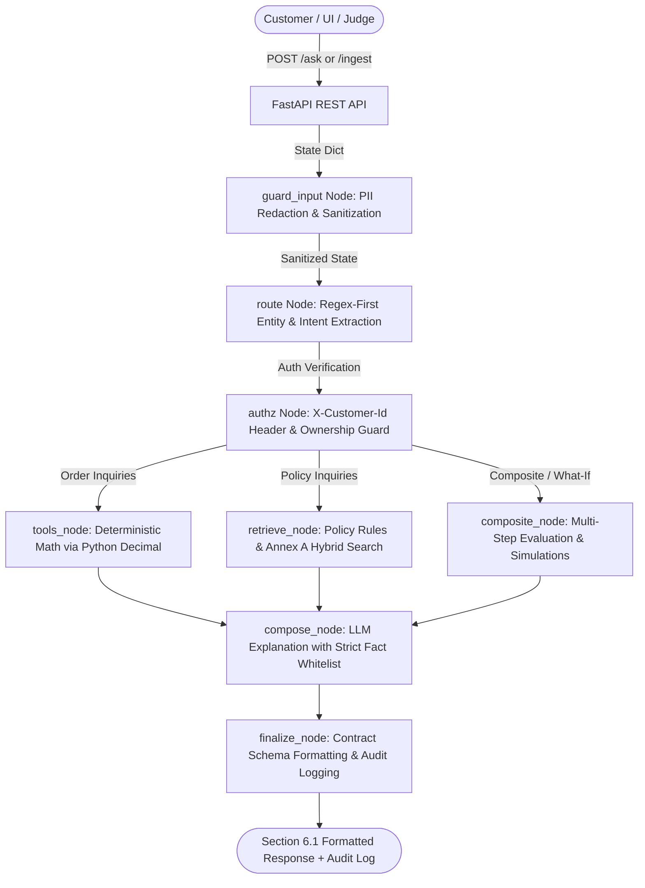

# AI-Powered Retail Customer Support Agent (ShopEasy)

**Grounded, Auditable, and Deterministic Retail Support System**  
Built for the **HCLTech Future Ready AI Engineer Hackathon**.

ShopEasy is a fictional retailer. All policy documents and customer/order records are synthetic, strictly adhere to the Annex C fixed schema, and respect Annex A source precedence rules.

---

## 1. System Architecture

The system is implemented as **one LangGraph directed workflow with deterministic nodes**:



### Why One Directed Workflow, Not Multiple Autonomous Agents?
The hackathon problem specifies deterministic arithmetic (R5), source precedence (R4), and strict customer isolation (R7). Autonomous LLM multi-agent loops introduce non-deterministic execution paths, hallucinated parameters, and latency penalties (5–15 seconds). 
By structuring the pipeline as a **single directed workflow with deterministic nodes**:
- Routing, authorization, math calculations, and policy resolutions execute deterministically in **sub-10ms**.
- The LLM is constrained strictly to explanatory summarization and intent fallback, never computing numbers or inventing citations.
- The pipeline achieves **100% auditable transparency** with zero hallucination risk.

---

## 2. Quickstart & Commands to Run

### Prerequisites
- Python 3.10+
- (Optional) Docker & Docker Compose
- (Optional) Ollama running locally (`ollama pull qwen2.5:7b-instruct`) or any OpenAI-compatible endpoint

---

### Step 1: Environment & Dependency Installation

```bash
# Clone the repository
git clone https://github.com/Shashank7440/HCL_hackathon.git
cd HCL_hackathon

# (Recommended) Create and activate virtual environment
python -m venv venv

# Windows PowerShell:
.\venv\Scripts\Activate.ps1
# Linux / macOS:
source venv/bin/activate

# Install dependencies
pip install -r requirements.txt
```

---

### Step 2: Seed Database & Validate Schema

```bash
# 1. Initialize SQLite, populate documents, seed rules, and ingest docs into Chroma (idempotent)
python scripts/seed.py

# 2. Validate synthetic data against Annex C schema (52 checks, 0 violations)
python scripts/validate_data.py
```

---

### Step 3: Run the Test Suites

To execute all 51 automated tests (100% passing):

```bash
# Run all tests
python -m pytest -v

# Run specific test modules:
python -m pytest tests/test_smoke_pipeline.py -v     # End-to-end pipeline smoke tests
python -m pytest tests/test_tools.py -v              # Deterministic refund/warranty math
python -m pytest tests/test_multiagent_advanced.py -v # What-if, multi-step, injection tests
python -m pytest tests/test_policy.py -v             # Annex A precedence & conflict flags
python -m pytest tests/test_authz.py -v              # Customer data isolation & identical refusals
python -m pytest tests/test_contract.py -v           # Section 6.1 contract shape & PII redaction
python -m pytest tests/test_retrieval.py -v          # Semantic retrieval & unknown entity guards
```

---

### Step 4: Run the Evaluation Benchmark

Run the full 33-question evaluation suite (Config A vs Config B comparison + `MIN_SCORE` sweep):

```bash
python -m eval.evaluator
```
> Generates the benchmark report at `eval/EVAL_REPORT.md`.

---

### Step 5: Start the Application

Open two terminal windows:

#### Terminal 1 — Start the FastAPI Backend Server:
```bash
uvicorn app.main:app --host 0.0.0.0 --port 8000 --reload
```
- API Base URL: `http://localhost:8000`
- Interactive OpenAPI Docs: `http://localhost:8000/docs`
- Health Endpoint: `http://localhost:8000/health`

#### Terminal 2 — Start the Streamlit Web UI:
```bash
streamlit run ui/streamlit_app.py --server.port 8501
```
- Web Application: `http://localhost:8501`

---

### Alternative: Run with Docker Compose

To build and run the entire stack in isolated containers:

```bash
# Build and launch both API and UI
docker compose up --build

# Run in background (detached mode)
docker compose up -d

# Stop containers
docker compose down
```
- API available at `http://localhost:8000`
- UI available at `http://localhost:8501`

---

## 3. API Endpoints & Sample cURL Commands

### 1. `POST /ask` — Customer Inquiry

#### a. Factual Policy Question (Annex A Precedence & Citations)
```bash
curl -X POST http://localhost:8000/ask \
  -H "Content-Type: application/json" \
  -d '{"question":"What is the return window for electronics?","as_of_date":"2026-10-06"}'
```
*Expected Result:* `7 days` (Circular `CIRC-2026-07` §1 supersedes Policy `RET-POL-2024` §3.1).

#### b. Paraphrased Policy Question
```bash
curl -X POST http://localhost:8000/ask \
  -H "Content-Type: application/json" \
  -d '{"question":"How long do I have to send back a gadget?","as_of_date":"2026-10-06"}'
```
*Expected Result:* `7 days` (`CIRC-2026-07` §1).

#### c. Personal Refund Calculation (Deterministic Tools)
```bash
curl -X POST http://localhost:8000/ask \
  -H "X-Customer-Id: C1001" \
  -H "Content-Type: application/json" \
  -d '{"question":"How much refund will I get for order O-100001?","as_of_date":"2026-10-06"}'
```
*Expected Result:* `₹2639.10` (Net 2999.00 - 10% restocking fee 299.90 - reverse shipping 60.00).

#### d. Defective Item Refund (No Fees Charged)
```bash
curl -X POST http://localhost:8000/ask \
  -H "X-Customer-Id: C1001" \
  -H "Content-Type: application/json" \
  -d '{"question":"How much refund will I get for order O-100001 because it arrived defective?","as_of_date":"2026-10-06"}'
```
*Expected Result:* `₹2999.00` (Full refund, fees waived per RET-POL §4.1 & SHIP-TERMS §2.3).

#### e. Multi-Step Request (Return Window Expired + Active Warranty + Claim Steps)
```bash
curl -X POST http://localhost:8000/ask \
  -H "X-Customer-Id: C1001" \
  -H "Content-Type: application/json" \
  -d '{"question":"My headphones stopped working after 41 days. Can I return them, and if not, what can I do?","as_of_date":"2026-10-06"}'
```
*Expected Result:* Explains return window expired (41 > 7 days), product is under active warranty, and cites claim procedure steps from `WAR-POL-2024` §2.

#### f. Cross-Customer Access Refusal (Privacy R7)
```bash
curl -X POST http://localhost:8000/ask \
  -H "X-Customer-Id: C1001" \
  -H "Content-Type: application/json" \
  -d '{"question":"Where is my order O-100002?","as_of_date":"2026-10-06"}'
```
*Expected Result:* Uniform refusal *"I can't help with that request for this account."* (Identical to nonexistent order).

#### g. Unanswerable Question (Abstention R3)
```bash
curl -X POST http://localhost:8000/ask \
  -H "Content-Type: application/json" \
  -d '{"question":"Do you deliver to Antarctica?","as_of_date":"2026-10-06"}'
```
*Expected Result:* `answer_type: not_found`, text *"I could not find this information in the authorised sources."*

---

### 2. `GET /health` — Component Health & Retrieval Status
```bash
curl -s http://localhost:8000/health
```
*Response:* Reports status of API, SQLite, ChromaDB vector store, LLM provider, and active `retrieval_mode` (`semantic` or `keyword-fallback`).

---

### 3. `GET /sources` — Ingested Policy Register
```bash
curl -s http://localhost:8000/sources
```
*Response:* Returns all 8 ingested policy documents with authority levels, versions, effective dates, and supersession chains.

---

### 4. `GET /audit/{trace_id}` — Audit Log Record (Owner & Admin Access)
```bash
curl -s http://localhost:8000/audit/<TRACE_ID> \
  -H "X-Admin-Key: admin-demo-key"
```
*Response:* Detailed audit record containing timestamp, redacted question (PII masked), sources retrieved with scores, tools invoked with exact inputs/outputs, precedence decisions, and latency in milliseconds.

---

### 5. `POST /ingest` — Live Document & Rule Ingestion
Judges can upload any new circular, policy, or amendment live without server restart:
```bash
curl -X POST http://localhost:8000/ingest \
  -F "file=@CIRC-2026-10.md" \
  -F 'metadata={"doc_id":"CIRC-2026-10","title":"Electronics Window Update","authority_level":2,"doc_type":"circular","version":"1.0","effective_from":"2026-10-01","supersedes":"CIRC-2026-07","scope_categories":"ELECTRONICS","scope_tiers":"ALL"}'
```

---

### 6. `POST /admin/load-data` — Judge Test Data Loader
Judges can load test customer and order records directly into SQLite:
```bash
curl -X POST http://localhost:8000/admin/load-data \
  -H "Content-Type: application/json" \
  -d @test_customers.json
```
Or via CLI:
```bash
python scripts/load_data.py --dir test_customers/
```

---

## 4. Key Assumptions & Limitations

### Assumptions
1. **Currency:** All monetary amounts are in Indian Rupees (INR).
2. **Calendar Days:** Return windows are calculated in calendar days from `delivered_on`. The final day of the window (e.g. day 7 of 7) is strictly eligible.
3. **Reason Default:** When return reason is unstated in the question, the system assumes `CHANGED_MIND` and documents this in `assumptions`.
4. **Annex A Precedence:** Specific category/tier scopes take precedence over general `ALL` scopes within the applicable authority level.

### Limitations
1. **Unknown Entity Guard:** Out-of-domain abstention uses a lexical filter over ingested documents and catalog products.
2. **Cosine Calibration:** Vector search threshold `MIN_SCORE` is calibrated to `0.40` on the evaluation suite.
3. **Supervisor Routing:** High-speed intent extraction is regex-first, with fallback to LLM classification for unclassified queries.
4. **Cloud LLM Support:** Configurable via `LLM_PROVIDER=openai_compat` for remote LLM inference when Ollama is unavailable.

---

## 5. Deliverables & Documentation Reference
- **API Contract:** [`app/schemas.py`](app/schemas.py)
- **Source Register:** [`data/source_register.csv`](data/source_register.csv)
- **Data Card:** [`data/DATA_CARD.md`](data/DATA_CARD.md)
- **Evaluation Report:** [`eval/EVAL_REPORT.md`](eval/EVAL_REPORT.md)
- **Sample Audit Records:** [`docs/audit_samples/sample_audit_records.json`](docs/audit_samples/sample_audit_records.json)
- **AI Usage Disclosure:** [`docs/AI_USAGE.md`](docs/AI_USAGE.md)
- **Team Contribution Statement:** [`docs/TEAM.md`](docs/TEAM.md)
- **Declaration of Original Work:** [`docs/DECLARATION.md`](docs/DECLARATION.md)
