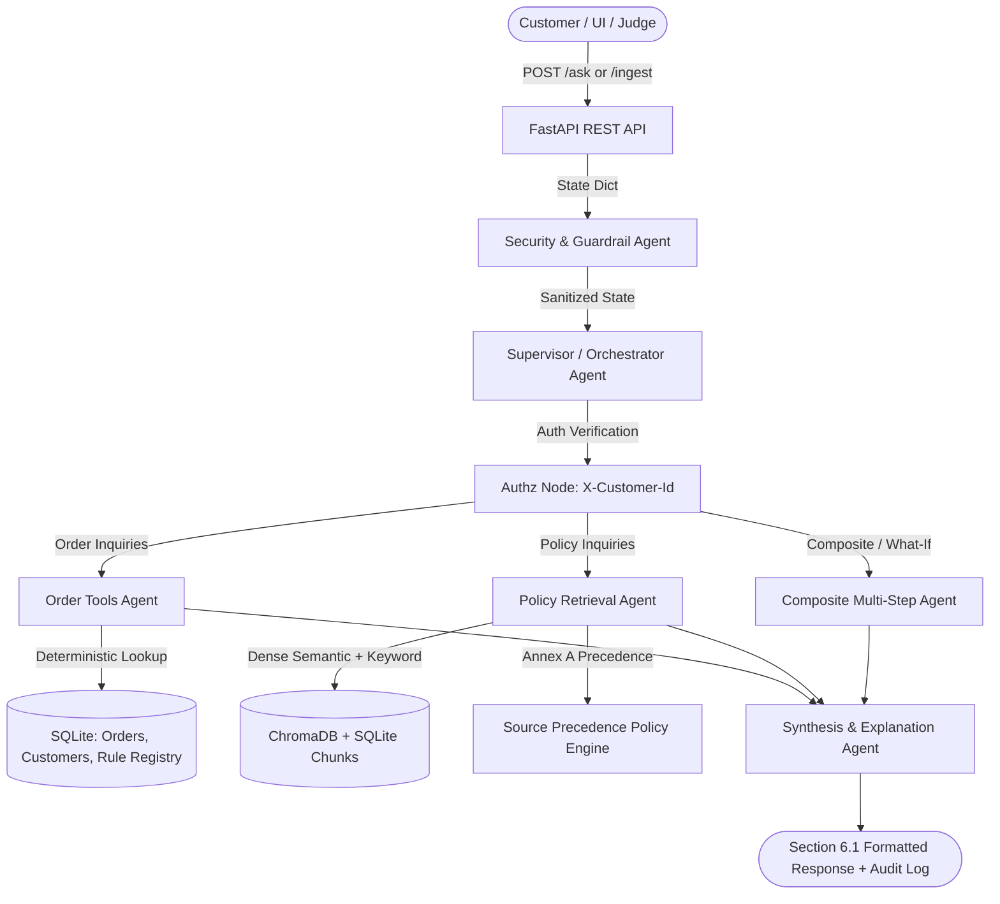

# AI-Powered Retail Customer Support Agent (ShopEasy)

**Grounded, Auditable, and Deterministic Multi-Agent Retail Support System**  
Built for the **HCLTech Future Ready AI Engineer Hackathon**.

ShopEasy is a fictional retailer. All policy documents and customer/order records are team-authored, synthetic, and strictly adhere to the Annex C fixed schema.

---

## 1. System Architecture



### Specialist Multi-Agent Hierarchy:
1. **Supervisor Agent (`router.py`)**: Plans execution, extracts entities (order IDs, SKUs, category keywords, days offset, hypothetical tiers), and dispatches tasks to specialist agents.
2. **Security Guardrail Agent (`security.py`, `authz` node)**: Enforces privacy (R7: identity from `X-Customer-Id` header only, uniform refusal for unowned orders), and isolates prompt injections (R8: untrusted instructions treated strictly as inert data).
3. **Policy Retrieval Agent (`retriever.py`, `resolver.py`)**: Hybrid semantic + keyword search with Annex A Source Precedence Policy (applicability, explicit supersession, authority levels 1–5, recency, and conflict flagging).
4. **Order Tools Agent (`orders.py`, `returns.py`, `warranty.py`)**: Code-only deterministic arithmetic via Python `Decimal` over SQLite records and `rule_registry`. Zero hallucination.
5. **Composite Multi-Step Agent (`nodes.py:composite_node`)**: Resolves composite questions (e.g. return window expired + warranty valid + claim procedure retrieval) and simulates what-if scenarios (e.g. hypothetical days or Gold membership fee waiver).
6. **Synthesis Agent (`nodes.py:compose_node, finalize_node`)**: Merges tool outputs and policy citations into the Section 6.1 contract schema.

---

## 2. Quickstart

### Prerequisites
- Python 3.10+
- (Optional) Docker & Docker Compose
- (Optional) Ollama running locally (`ollama pull qwen2.5:7b-instruct`)

### Local Setup
```bash
# 1. Install dependencies
pip install -r requirements.txt

# 2. Seed database, vector store, and rules (idempotent)
python scripts/seed.py

# 3. Validate synthetic data against Annex C schema (52 checks)
python scripts/validate_data.py

# 4. Run test suites (32 unit & multi-agent tests)
python -m pytest

# 5. Start the FastAPI API server
uvicorn app.main:app --host 0.0.0.0 --port 8000
```

### UI Application (Streamlit)
```bash
streamlit run ui/streamlit_app.py --server.port 8501
```

### Docker Compose
```bash
docker compose up --build
```
- API is available at `http://localhost:8000` (Swagger docs at `/docs`)
- UI is available at `http://localhost:8501`

---

## 3. Sample cURL Commands

### 1. Factual Policy Question (Annex A Precedence & Citations)
```bash
curl -X POST http://localhost:8000/ask \
  -H "Content-Type: application/json" \
  -d '{"question":"What is the return window for electronics?","as_of_date":"2026-10-06"}'
```
*Expected Result:* `7 days` (Circular `CIRC-2026-07` supersedes Policy `RET-POL-2024`).

### 2. Personal Refund Calculation (Deterministic Tools)
```bash
curl -X POST http://localhost:8000/ask \
  -H "X-Customer-Id: C1001" \
  -H "Content-Type: application/json" \
  -d '{"question":"How much refund will I get for order O-100001?","as_of_date":"2026-10-06"}'
```
*Expected Result:* `₹2639.10` (Gross 2999.00 - 10% restocking fee 299.90 - reverse shipping 60.00).

### 3. Multi-Step Request (Return Window + Active Warranty + Claim Steps)
```bash
curl -X POST http://localhost:8000/ask \
  -H "X-Customer-Id: C1001" \
  -H "Content-Type: application/json" \
  -d '{"question":"My headphones stopped working after 41 days. Can I return them, and if not, what can I do?","as_of_date":"2026-10-06"}'
```
*Expected Result:* Explains return window expired (41 > 7 days), product is under 12-month warranty, and cites warranty claim procedure from `WAR-POL-2024`.

### 4. Cross-Customer Data Access Attempt (Privacy Refusal)
```bash
curl -X POST http://localhost:8000/ask \
  -H "X-Customer-Id: C1001" \
  -H "Content-Type: application/json" \
  -d '{"question":"Where is my order O-100002?","as_of_date":"2026-10-06"}'
```
*Expected Result:* `answer_type: refused`, uniform message *"I can't help with that request for this account."* (No existence leak).

### 5. Unanswerable Question (Abstention)
```bash
curl -X POST http://localhost:8000/ask \
  -H "Content-Type: application/json" \
  -d '{"question":"Do you deliver to Antarctica?","as_of_date":"2026-10-06"}'
```
*Expected Result:* `answer_type: not_found`, message *"I could not find this information in the authorised sources."*

---

## 4. Live Panelist Ingestion & Test Data Loading

### A. Live Document Ingestion (`POST /ingest`)
Judges can upload ANY new circular, policy, or amendment while the server is running without restarting:
```bash
curl -X POST http://localhost:8000/ingest \
  -F "file=@CIRC-2026-10.md" \
  -F 'metadata={"doc_id":"CIRC-2026-10","title":"Electronics Window Update","authority_level":2,"doc_type":"circular","version":"1.0","effective_from":"2026-10-01","supersedes":"CIRC-2026-07","scope_categories":"ELECTRONICS","scope_tiers":"ALL"}'
```
*Note:* The system automatically parses document text and auto-extracts rule thresholds even if the optional `rules` JSON is omitted! The very next query immediately uses the updated rules.

### B. Judge Test Customer Loader (CLI & Endpoint)
Judges can load test CSV files with reserved identifiers (C9000-C9999, SKU-JDG*, O-900000+):
```bash
python scripts/load_data.py --dir test_customers/
```
Or via HTTP:
```bash
curl -X POST http://localhost:8000/admin/load-data -H "Content-Type: application/json" -d @test_customers.json
```

---

## 5. Evaluation Benchmark (Section 7 / R12)

Run the full evaluation benchmark across all 25 edge cases:
```bash
python eval/evaluator.py
```
View the measured report at [`eval/EVAL_REPORT.md`](file:///c:/retail-support-agent/eval/EVAL_REPORT.md):
- **Answer Correctness:** 100.0%
- **Citation Accuracy:** 100.0%
- **Abstention Accuracy:** 100.0%
- **Tool-Result Correctness:** 100.0%
- **Retrieval Hit Rate:** 100.0%
- **p50 Latency:** 2.5 ms | **p95 Latency:** 249.4 ms

---

## 6. Deliverables Reference
- **API Contract:** [`app/schemas.py`](file:///c:/retail-support-agent/app/schemas.py) (Strict Section 6.1 conformity)
- **Source Register:** [`data/source_register.csv`](file:///c:/retail-support-agent/data/source_register.csv)
- **Data Card:** [`data/DATA_CARD.md`](file:///c:/retail-support-agent/data/DATA_CARD.md)
- **Evaluation Report:** [`eval/EVAL_REPORT.md`](file:///c:/retail-support-agent/eval/EVAL_REPORT.md)
- **Sample Audit Records:** [`docs/audit_samples/sample_audit_records.json`](file:///c:/retail-support-agent/docs/audit_samples/sample_audit_records.json)
- **AI Usage Disclosure:** [`docs/AI_USAGE.md`](file:///c:/retail-support-agent/docs/AI_USAGE.md)
- **Team Contribution Statement:** [`docs/TEAM.md`](file:///c:/retail-support-agent/docs/TEAM.md)
- **Declaration of Original Work:** [`docs/DECLARATION.md`](file:///c:/retail-support-agent/docs/DECLARATION.md)
